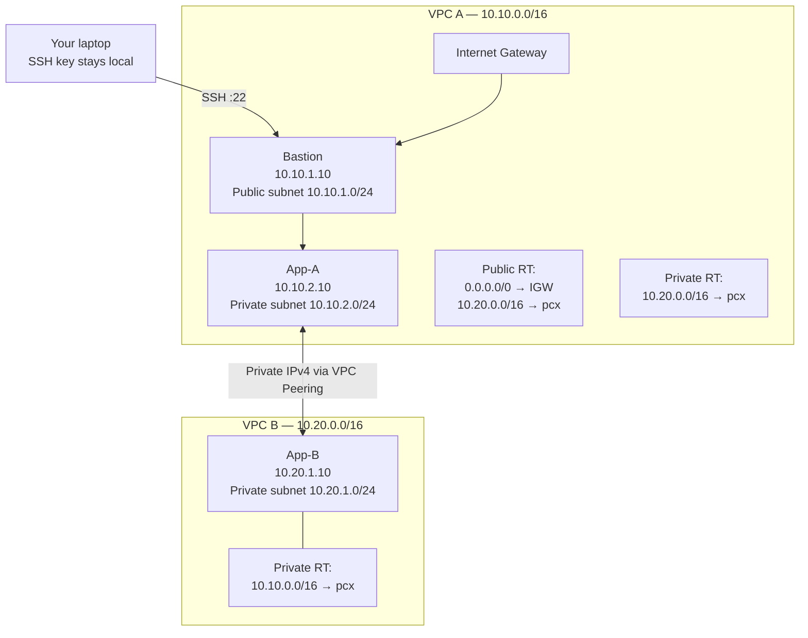

# CloudLink: AWS VPC Peering Lab — Portfolio-Ready Project

**Goal:** Build and prove private IPv4 connectivity between two AWS VPCs using VPC Peering, private EC2 workloads, a tightly scoped bastion host, route tables, and security groups.

This project follows the uploaded EWB Courses *AWS VPC Peering Student Project Workbook* (October 2026). The workbook's core topology is preserved, with extra portfolio deliverables: an architecture diagram, validation scripts, a resource checklist, an evidence template, and a viva guide.

> **Important:** This ZIP contains project files and scripts; it does not create AWS resources automatically and does not contain real AWS test results. Run the lab in your own AWS account, record your actual resource IDs/IPs, and capture your own terminal and console evidence.

## Why this is a strong portfolio project
- Demonstrates cloud networking fundamentals beyond a simple EC2 deployment.
- Uses two non-overlapping VPC CIDRs and explicit subnet/route-table design.
- Proves both positive connectivity and a controlled negative test.
- Keeps application instances private and uses SSH ProxyJump through one bastion.
- Includes repeatable validation, troubleshooting, cleanup, and interview explanations.

## Architecture at a glance

## Address and resource plan

| Resource | Name | CIDR / address |
|---|---|---|
| VPC A | `ewb-vpc-a` | `10.10.0.0/16` |
| Public subnet A | `ewb-a-public` | `10.10.1.0/24` |
| Private subnet A | `ewb-a-private` | `10.10.2.0/24` |
| VPC B | `ewb-vpc-b` | `10.20.0.0/16` |
| Private subnet B | `ewb-b-private` | `10.20.1.0/24` |
| Bastion | `ewb-bastion` | `10.10.1.10` + public IPv4 |
| App-A | `ewb-app-a` | `10.10.2.10`, no public IPv4 |
| App-B | `ewb-app-b` | `10.20.1.10`, no public IPv4 |
| Peering | `ewb-a-b-peer` | record your actual `pcx-...` ID |

Use one AWS account and Region for the base lab. The workbook suggests Mumbai (`ap-south-1`) as an example. Keep the CIDRs non-overlapping.

## Repository contents

- `docs/architecture.md` — design and packet-flow explanation
- `docs/build-guide.md` — console build sequence based on the workbook
- `docs/security-and-routing.md` — route and security group matrix
- `docs/test-plan.md` — baseline, positive, negative, and recovery tests
- `docs/viva-questions.md` — interview / viva preparation
- `docs/evidence-template.md` — report checklist and placeholders
- `scripts/validate-host.sh` — checks a Linux host's expected network identity
- `scripts/connectivity-test.sh` — runs ping tests to a peer private IP
- `scripts/cleanup-checklist.sh` — prints safe cleanup reminders; it does not delete anything
- `ssh/config.example` — SSH ProxyJump config template
- `LICENSE` — MIT license

## Build sequence

1. Read the cost and cleanup warnings below.
2. Follow `docs/build-guide.md` to create the two VPCs, three subnets, internet gateway, route tables, security groups, and EC2 instances.
3. Verify the baseline failure before creating peering.
4. Create and accept `ewb-a-b-peer`.
5. Add the forward and return routes to all three route tables exactly as shown in `docs/security-and-routing.md`.
6. Run `scripts/connectivity-test.sh` from each private host, then complete the controlled ICMP rule-removal test.
7. Fill `docs/evidence-template.md` with your actual IDs, screenshots, outputs, and cleanup evidence.

## Cost and safety notes

- AWS resources may incur charges, including EC2, EBS storage, and public IPv4 addresses. Check current pricing and account credits before launching.
- This lab needs no NAT Gateway. Do not add one unless you intentionally extend the project.
- Do not expose SSH or ICMP to `0.0.0.0/0`.
- The bastion's inbound SSH source must be your current public IPv4 with `/32`.
- Keep the private key on your own laptop. Never commit `.pem` files, credentials, access tokens, or account IDs.
- App-A and App-B must not have public IPv4 addresses.
- VPC peering is non-transitive and does not give VPC B internet access through VPC A's internet gateway.
- Complete the cleanup checklist after saving evidence.

## Suggested portfolio description

**CloudLink — Secure AWS VPC Peering Lab**  
Designed and validated private connectivity between two non-overlapping Amazon VPCs using VPC Peering, custom route tables, private EC2 instances, and least-privilege security-group rules. Verified baseline isolation, bidirectional ICMP connectivity, SSH access through a bastion with ProxyJump, and a controlled security-rule failure/recovery. Documented architecture, route selection, troubleshooting, and teardown.

Only claim implementation and results after you have actually run the lab.
